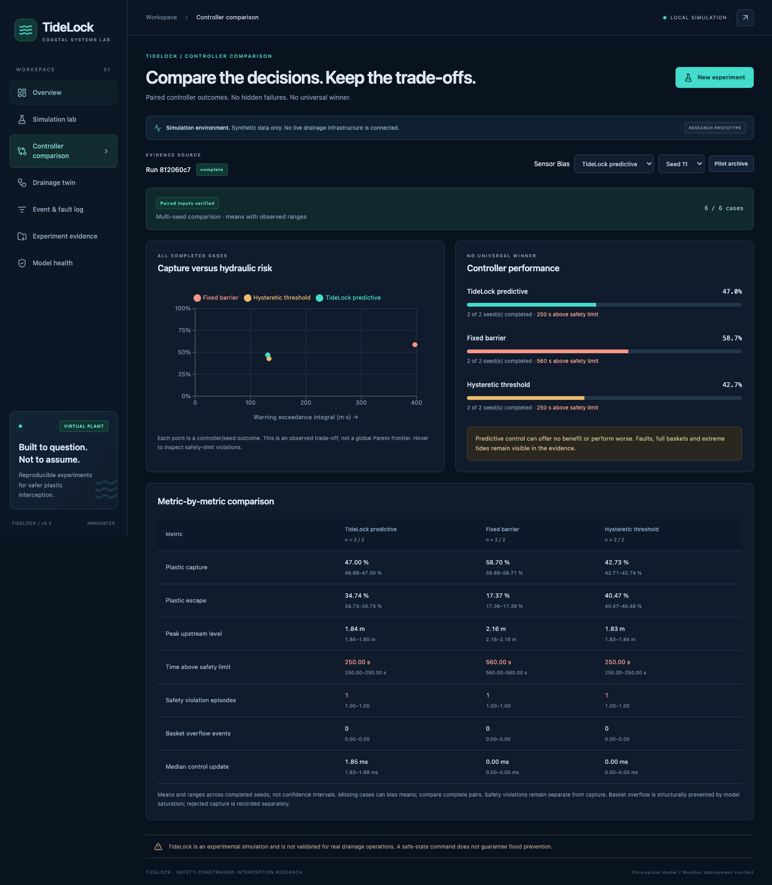

# Dashboard verification record

Executed locally on 10 October 2026, macOS, Python 3.12, Node 26.5 and installed Google Chrome. This verifies the software journey; it does not validate drainage hydraulics or field safety.

| Check | Actual result |
|---|---|
| Original test suite before implementation | 9 physics tests passed |
| Final backend suite | 16 tests passed, including all 9 original physics tests |
| Frontend unit/component/client suite | 9 tests passed |
| TypeScript and Vite production build | Passed; separate application and chart bundles |
| Chrome browser tests | 3 tests passed: full real simulation journey, mobile layout, API outage/retry |
| Source formatting | Prettier check passed |
| Simulator and pilot preservation | No Git difference from `main` in `tidelock/` or `results/pilot/` |
| Evidence reader coverage | All 51 archived scenario/controller traces returned successfully; all remain seed 11 |

The backend tests run six real cases in a process worker, retrieve their traces/events/updates, validate paired disturbances and download CSV/JSON outputs. They also exercise malformed requests, duplicate/idempotent submissions, bounded queues, partial failures, failed workers, restart recovery, exclusive writer locking, forbidden origins, file traversal rejection, evidence pagination and unchanged pilot-file hashes.

The browser journey selects sensor bias, all three controllers and seeds 11/23; runs six real cases; checks a displayed capture metric against the API; inspects comparison, recorded replay, injected fault and critical safety event; browses checks and paginated historical metrics; downloads and parses generated CSV and JSON evidence; and opens model limitations. No browser page errors were observed. The mobile check uses a 390 × 844 viewport and verifies that content does not overflow horizontally. API outage recovery is deliberately simulated in that one test; the main journey uses the actual backend and simulator.

An archive parsing bug found during testing was corrected: textual event details and reliability reasons retain their string values, including numeric-looking command descriptions. Shutdown handling lets the API drain accepted work instead of sending Ctrl+C into its computation worker. Failed cases retain their status and sanitized errors instead of disappearing from comparisons.

Visual inspection covered the complete desktop and mobile overview and the comparison. Images below are browser captures of real pilot or generated results, not mockups.

Known test-tool notices: Starlette warns that its httpx-based TestClient adapter is deprecated; the pinned adapter still passes the suite. Node may print a NO_COLOR/FORCE_COLOR environment warning. Neither notice is a simulation result or a skipped check. No hardware, remote hosting, Windows or Colab dashboard test was performed.
