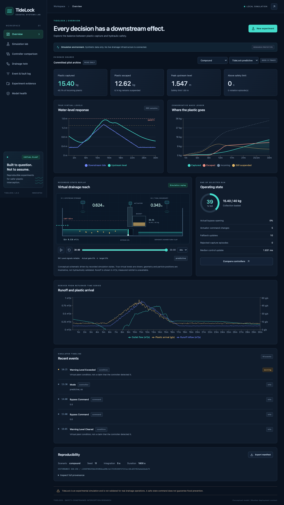

# TideLock interactive simulation dashboard

The dashboard executes the existing Python simulator and renders its returned states. It has no connection to physical drainage infrastructure. The original simulator, controllers, benchmark and committed pilot evidence are preserved.

> TideLock is an experimental simulation and is not validated for real drainage operations. A safe-state command does not guarantee flood prevention.

## Install and launch

From the repository root on `feature/dashboard`, with Python 3.12+ and Node 22.12+:

```bash
python3 -m venv .venv
source .venv/bin/activate
python -m pip install -r requirements-dashboard-lock.txt
npm --prefix frontend ci
npm --prefix frontend run build
python -m uvicorn dashboard_api.app:app --host 127.0.0.1 --port 8000
```

On Windows, activate `.venv\Scripts\activate` instead. The pinned dependencies were tested on macOS, Python 3.12 and Node 26; other operating systems were not tested. `requirements-dashboard.txt` contains the compatible top-level dependency ranges; `requirements-dashboard-lock.txt` records the exact tested environment. The original numerical-only `requirements-lock.txt` is unchanged.

Dashboard: http://127.0.0.1:8000

Interactive API documentation: http://127.0.0.1:8000/docs

OpenAPI schema: http://127.0.0.1:8000/openapi.json

Build before starting the API: the backend mounts `frontend/dist` only if that folder exists at startup. Stop with Ctrl+C. A graceful shutdown waits for accepted simulations. Run only **one API worker**; a file lock prevents two API processes from writing the same result directory.

For frontend development, keep the API running and use another terminal:

```bash
npm --prefix frontend run dev
```

Open http://127.0.0.1:5173. Vite forwards API and API-documentation requests to port 8000. The production build uses a single origin and does not require Vite.

### Google Drive

The source repository can live in `My Drive/TideLock`. Drive is file storage, not application hosting: the Python server still runs on your computer. Prefer a local run directory outside Drive to avoid cloud-sync interference with locks and atomic result updates:

```bash
export TIDELOCK_DATA_DIR="$TMPDIR/tidelock-runs"
python -m uvicorn dashboard_api.app:app --host 127.0.0.1 --port 8000
```

The temporary directory example is convenient for demos but may be removed by the operating system. Choose a persistent local directory for long-term evidence. The default is `.tidelock/runs` under the repository. Do not run two machines against the same cloud-synced result directory. The original Colab feasibility notebook remains independent of this local dashboard; serving this interface from Colab has not been implemented.



## Functional screens

| Screen | Actual data and interactions |
|---|---|
| Overview | Capture/escape, true peak level, safety episodes/duration, water/plastic/runoff charts, basket fill, actuator state, events and provenance |
| Simulation lab | 17 engine-supported scenarios, 1–3 controllers, 1–10 unique seeds, supported duration/step options, hysteresis and predictive-cap settings, validation and progress |
| Controller comparison | Same scenario/seed/step per controller; disturbance-hash checks, single-seed outcomes or multi-seed means/ranges, capture/risk scatter, negative outcomes and failed cases |
| Drainage twin | Play, pause, scrub, change speed and jump to faults/maintenance/safety events using recorded states |
| Event & fault log | Search and filter by severity/category; injected faults, sensor reliability checks, commands and true virtual conditions are distinguished |
| Experiment evidence | Read-only pilot file browser with CSV pagination, JSON/text/image inspection, persistent generated-run history, CSV and JSON downloads |
| Model health | Conservation residuals, reliability/fallback counts, safety outcomes, selected model parameters, metric definitions, assumptions and unavailable measurements |

The initial display uses the real committed compound-scenario predictive-controller trace for seed 11. It is explicitly labeled as an archive. Only seed 11 has archived per-step traces; the comparison can use all five pilot seeds without fabricating missing traces. New experiments retain every requested case, including failures. Physical basket overflow is structurally prevented by the original model; rejected capture is shown separately.

## Architecture and files

```text
Browser (React + TypeScript + Tailwind + Recharts + Lucide)
    │ typed same-origin HTTP client
FastAPI routes + Pydantic schemas
    ├─ allowlisted, read-only results/pilot
    └─ RunStore: file lock, atomic JSON writes, bounded queue
           └─ one process worker → existing tidelock.simulation.simulate
                   └─ .tidelock/runs/<run-id>/
```

- `dashboard_api/schemas.py`: validated requests, status, metrics, traces, events and comparison contracts.
- `dashboard_api/integration.py`: simulator adapter, comparison aggregation and clearly classified event enrichment.
- `dashboard_api/store.py`: bounded execution, persistent states, duplicate guards and recovery after interrupted runs.
- `dashboard_api/evidence.py`: allowlisted pilot readers and CSV type handling.
- `dashboard_api/app.py`: REST routes, local-origin policy, downloads and built frontend serving.
- `frontend/src/api.ts`, `types.ts`: typed client and shared UI contracts.
- `frontend/src/App.tsx`: selected experiment, polling and seven-screen navigation.
- `frontend/src/components/`: reusable panels, laboratory, charts, replay, evidence, comparison, events and model health.
- `frontend/src/styles.css`: navy/cyan design, mobile navigation, responsive layouts and focus/reduced-motion support.
- `tests/test_dashboard.py`: backend integration, real process execution, validation, preservation, failures and queue tests.
- `frontend/src/test/`: component/input/client tests.
- `frontend/e2e/journey.spec.ts`: real browser journey, mobile layout and outage recovery.
- `.gitignore`: excludes dependencies, compiled assets, generated runs and test artifacts.

`tidelock/` and `results/pilot/` are unchanged. Generated dashboard results are not placed in the pilot folder.

## REST contract

| Method | Endpoint | Purpose |
|---|---|---|
| GET | `/api/health` | Simulation-only status, queue and worker limits, warning |
| GET | `/api/scenarios`, `/api/controllers`, `/api/model` | Supported configuration and assumptions |
| POST | `/api/runs` | Validate and enqueue; returns HTTP 202 and run ID |
| GET | `/api/runs`, `/api/runs/{id}` | Persistent history and status |
| GET | `/api/runs/{id}/manifest` | Configuration, model settings and source hashes |
| GET | `/api/runs/{id}/metrics` | Completed case metrics |
| GET | `/api/runs/{id}/cases/{case}` | Full completed case |
| GET | `/api/runs/{id}/cases/{case}/traces`, `/events`, `/updates` | Recorded time series, classified events or control updates |
| GET | `/api/runs/{id}/comparison` | Aggregates, individual outcomes and failures |
| GET | `/api/runs/{id}/export?kind=metrics&format=csv` | Download metrics, traces, events or updates as CSV/JSON |
| GET | `/api/runs/{id}/export?kind=summary&format=json` | Status, manifest and comparison JSON |
| GET | `/api/evidence/pilot` | Read-only file inventory |
| GET | `/api/evidence/pilot/case?scenario=compound&controller=predictive` | Actual archived seed-11 case |
| GET | `/api/evidence/pilot/comparison?scenario=compound&multi_seed=true` | All five pilot seeds |
| GET | `/api/evidence/pilot/files/{name}?offset=0&limit=50` | Structured evidence with CSV pagination |
| GET | `/api/evidence/pilot/download/{name}` | Original allowlisted evidence download |

Example request body:

```json
{
  "scenario": "sensor_bias",
  "controllers": ["fixed", "threshold", "predictive"],
  "seeds": [11, 23],
  "duration_s": 1800,
  "dt_s": 5,
  "threshold_open_m": 1.3,
  "threshold_close_m": 1.1,
  "predictive_cap_m": 1.6
}
```

Durations: 300, 600, 900, 1200 or 1800 seconds. Integration intervals: 2.5 or 5 seconds. Seeds must be unique integers from 0 through 4294967295, at most ten. Controllers must be unique and nonempty. The close threshold must be below the open threshold. Threshold and predictive-cap bounds are enforced by Pydantic. Extra request fields are rejected. Short runs warn when they end before the configured fault or maintenance event.

Status lifecycle: `queued → running → complete | partial | failed`. `completed_cases` counts processed cases, including failures; `comparison.successful_cases` counts only successful simulations. Case IDs are `<controller>-<seed>`. Computation timings are measured on the executing computer and are not deterministic.

Pass an `Idempotency-Key` header to replay the same submission safely. Reusing it with a different configuration returns 409. Identical active configurations also reuse the existing job. At most three jobs may be queued/running in total, with one computation worker and at most thirty cases per job. Queue saturation returns 429. A 200-run storage cap returns 507; archive completed folders while the server is stopped before creating more runs. No retention deletion is automatic.

Expected errors use `{"error":{"code":"...","message":"..."}}`. Invalid inputs return 422; unavailable IDs/files return 404; failed-case retrieval or unavailable CSV data return 409. Filesystem paths are not accepted in simulation requests. Evidence resolution is limited to allowlisted files beneath the pilot directory. No actuator-control endpoint exists.

Run folders contain atomic `run.json`, `manifest.json` and one case JSON per successful case. Case failures retain their status and sanitized error; detailed exceptions are in server logs. On restart, unfinished jobs become failed and preserve any completed cases. They are not silently rerun. Graceful shutdown waits for accepted work; forced shutdown may leave a partial run. Copy the entire completed run folder to archive it.

## Reproducibility and limitations

Source SHA-256 hashes cover simulator and adapter Python modules. Manifests record validated configuration and model parameters; metrics record seeded disturbance hashes. The same seed, scenario and integration step produce the same physical outcomes with the same source/dependencies. Compute times and creation times vary. Dependency locks accompany the source; hashes do not include the frontend, dependencies or machine hardware.

The interface is a local, single-user research application. It has no authentication, remote deployment configuration, shared database, durable external queue or hardware safety certification. Bind to loopback as shown; do not expose it as a public service. CORS/Origin and Host checks restrict browser access to the documented local addresses; these are not a replacement for authentication in a hosted deployment.

The twin is conceptual. Geometry, particle positions and wave graphics are illustrative. The actual water levels, flow, captured/escaped mass, actuator positions and basket fill are returned by the existing simulator. Runoff is displayed in m³/s; measured rainfall, field calibration, structural loads, marine corrosion, complete power loss and validated deployment costs are unavailable. Full-basket saturation is not a physical overflow model. Fixed and threshold control can outperform predictive control on individual criteria. No global safety guarantee or universal superiority is claimed.

Means and observed min/max ranges are descriptive, not confidence intervals. Incomplete comparisons explicitly retain failures; means over surviving cases can be biased. Safety violations remain visible separately from capture performance. The Mumbai context is conceptual; no surveyed outlet data was introduced.

## Verification

Run backend and original physics tests:

```bash
python -m unittest discover -s tests -v
```

Frontend component/client tests and production build:

```bash
npm --prefix frontend test
npm --prefix frontend run build
```

With the API serving the built dashboard at port 8000 and Google Chrome installed:

```bash
npm --prefix frontend run test:e2e
```

The Playwright configuration uses installed Chrome (`channel: 'chrome'`); it does not bundle a browser. Test runs create real, separately stored experiments. Browser screenshots and failure traces go into ignored `frontend/test-results/`. Unit tests use temporary result directories and deliberate failures to verify containment. See `dashboard-verification.md` for the executed results.

## InnovateX demo sequence (about 3 minutes)

1. **Overview (30 s):** show the committed compound scenario, explain capture versus upstream level, then switch the displayed controller to Fixed barrier to reveal its safety violation. Say explicitly that this is synthetic evidence.
2. **Simulation lab (35 s):** choose Sensor bias, all three controllers, seeds `11,23`, duration 30 minutes and 5-second integration. Run the real simulator and show six processed cases.
3. **Controller comparison (35 s):** inspect identical-input verification, means/ranges and the capture/risk scatter. Point out adverse sensor-fault outcomes rather than claiming predictive superiority.
4. **Twin and log (35 s):** select predictive seed 11, jump to the 10:00 injected fault, play recorded states, then filter critical virtual conditions. Distinguish fault injection from actual detection.
5. **Evidence (30 s):** open pilot checks or convergence, download generated metrics CSV and summary JSON, and show the disturbance/source hashes.
6. **Model health (15 s):** explain conservation checks versus physical validity, unavailable field data and the safe-state warning. Position site calibration and hardware validation as next work.
