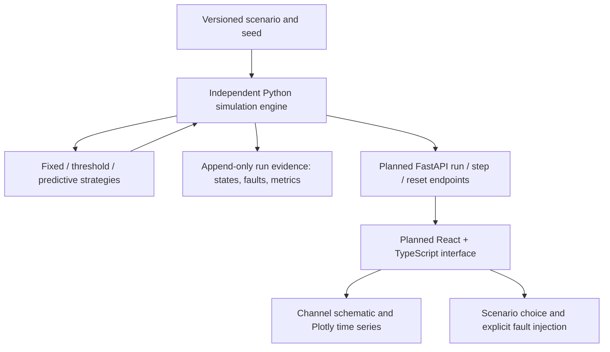

# TideLock implementation, deployment and presentation plan

## 1. Precise problem statement

For a screened drainage outlet with finite collection capacity and a time-varying tidal boundary, determine bypass actions that retain the most macroplastic while preserving an upstream water-level limit whenever the modeled system has a feasible action. Identify and expose conditions where that limit is unattainable. Quantify whether predictive action adds value over hysteretic control under the same disturbances and hardware limits.

The present artifact completes the research-first stage: source review, three ranked contribution directions, a minimal mathematical plant, three controllers and a reproducible pilot. It does not claim that the complete requested dashboard, production safety system or final competition submission has been built.

## 2. Implementation architecture and next increment

Current modules: model.py owns conservative physics; scenarios.py owns shared seeds/inputs; controllers.py contains the three policies; simulation.py handles virtual hardware, observation boundaries, logs and metrics; benchmark.py exports evidence. Tests exercise physical invariants and edge cases. A Google Colab notebook can run the project from My Drive.

Next architecture, when the model is stable:

No database, cloud scheduler, authentication layer or heavy 3D engine is needed for the first demonstration. Keep engine time distinct from wall time. The engine returns version, scenario hash, current simulation time, true virtual state, sensed state, command, actual actuator position and event records. Label true versus sensed values in the operator view. A local bounded step endpoint avoids browser-owned physics. Reset must reconstruct the same initial conditions and disturbance stream for all strategies. Capture and escape panels must include suspended inventory.

Prioritize deterministic run/reset and clear failure states before streaming. The UI should show upstream/downstream level, forecast envelope, warning/safety levels, basket fill, bypass position, mode, quality flags and a three-controller comparison. Keyboard-operable controls, explicit units, text alarms and labels beyond color are required. Never label an uncertain fallback as “safe.” A diagram and ordinary time-series charts are enough.

## 3. Benchmark and validation roadmap

The locked pilot protocol is in experiment_protocol.md. The pilot passes conservation, ordinary-condition safety, numerical-refinement and compute-time targets. Its predeclared +5 percentage-point capture hypothesis holds for monsoon and compound scenarios relative to the main threshold setting. It is not a general proof: the compound warning-exceedance integral is slightly worse for the default predictive setting despite a lower peak. The separate cap sweep illustrates sensitivity and is not a held-out optimized comparison.

Before a stronger performance claim:

1. **Independent plant:** compare storage trajectories with a separate hydraulic implementation, then a SWMM case with tidal boundary and the same branch topology. The present controller and plant share the same model structure, favoring model-based control.
2. **Strong baselines:** calibrate a passive high-flow bypass and tune threshold/hysteresis on separate training events; give MPC an equal tuning budget. Include an always-open reference to establish drainage capacity.
3. **Ablations:** remove basket-state dependence, replace future runoff with persistence, remove tide forecasts, and compare finite uncertainty sampling with nominal prediction. These establish which feature contributes.
4. **Fault coverage:** validate a state observer and independent local interlock. Add slow drift, simultaneous faults, all-signal loss, complete power loss, partial actuator-speed loss, jam at several positions, flap fouling and false alarms. Current post-fault recovery means return to three consecutive non-alert controller updates; it is not proof of hydraulic recovery.
5. **Generalization:** at least 20 unseen seeds and varied event shapes, forecast errors, load timings, geometry, capture curves and initial states. Paired confidence intervals across independent events are preferable to treating 5-second samples as independent observations.
6. **Transport:** measure floating inventory, residence time, size distribution, wet mass versus volume, backwash and re-entrainment. Close the observation window with a washout period or report terminal stored mass.

Stop increasing algorithm complexity if tuned passive or threshold control provides comparable capture and risk. Keep failed cases in the evidence package.

## 4. Cost and maintenance model in INR

**No field quotations or surveyed bill of quantities have been obtained. A credible field-pilot total is therefore not yet available.** Assigning a precise low hardware price would be misleading. Use the following cost model to obtain quotations, rather than treating a hobby sensor price as a deployed-system budget.

| Cost item | INR model / evidence required |
|---|---|
| Initial software prototype | ₹0 incremental paid software/service purchases for this local run; existing laptop, electricity and team time excluded, not free |
| Development labor | H_model × R_model + H_control × R_control + H_interface × R_interface; hours and INR/hour to be recorded |
| Two level sensors | 2 × installed unit quote; specify range, datum, mounting, corrosion/exposure, calibration and surge protection |
| Controller, local interlock, encoder and power | Itemized INR quotations including backup and manual override |
| Bypass, screen, basket and nonreturn assembly | Site-specific fabrication and structural design quote; no material or load rating selected yet |
| Civil works and safe access | Survey, mounting, walkway/lifting access, drainage isolation, reinstatement and installation labor quotes |
| Calibration / replacement | Visits/year × visit rate + sensors replaced/year × installed sensor price |
| Debris removal and cleaning | Visits/year × (crew-hours × INR/hour + transport + disposal/handling fee) |
| Inspection and corrosion control | Inspections/year × inspection rate + coating/repair allowance supported by supplier and exposure assessment |
| Energy and communications | kWh/year × actual tariff + 12 × monthly data plan; local control must not depend on internet availability |
| Downtime / flood consequences | Record outage hours and hazard scenarios; expected loss requires defensible probabilities and consequence data, currently unknown |

Annual cost = annualized installed capital + operations + maintenance + verified expected loss. Cost per kg = annual cost / **net plastic delivered to the handling chain**, accounting for re-release and sorting rejects. Do not claim a recycling revenue stream until waste composition, contamination and an accepting processor are known. Do not claim avoided-flood rupees from the virtual plant.

Capital annualization may use a chosen service life and financing assumption, both declared. A no-financing comparison can simply show installed capital plus five years of operating costs without asserting a financial return. Cost sensitivity should center on cleaning frequency and crew access; doubling visits can overwhelm sensor savings. Ownership could sit with a municipal drainage operator and a contracted maintenance/waste-handling team, but procurement fit has not been established.

For the next lab build, get separate low-voltage sensor/actuator quotes and a flume-access quote. Maker hardware is for controlled experiments and must not be presented as certified field equipment. No purchase has been made.

## 5. Mumbai deployment and scalability

The [BMC Mahul hydraulic-control specification](https://portal.mcgm.gov.in/irj/go/km/docs/documents/Tenders/ETH/ETH_7000021132_1_120822.pdf) is evidence of the local operational problem, not a selected TideLock pilot site. Start with a drainage engineer and a ward-level maintenance team to identify an accessible small outlet where existing flood protection remains intact. Malad or Trombay are possible investigation contexts in the competition brief, not approved installations.

Required data: synchronized upstream/downstream levels on one surveyed datum; outlet geometry and roughness; rainfall/runoff time series; tide/storm-surge boundary; existing gates/pumps and operating rules; debris mass/volume/composition versus flow; screen head loss at different fills; maintenance frequency; access and lifting constraints; adjacent properties and flood pathways; communications and power reliability. Do not mix tide-table elevations with local invert depths without datum conversion.

Obtain site-owner and relevant BMC drainage approvals before installation; coordinate solid-waste collection responsibilities and ask the responsible authorities which environmental/coastal permissions apply to that exact site. This is a planning dependency, not a legal determination. No authority has been contacted and no permissions are represented as granted.

Stages: (1) reproduce software evidence; (2) optional hardware-in-the-loop timing and fault tests with a benign load; (3) closed-loop flume using recoverable test debris and captured effluent; (4) small supervised pilot only after hydraulic, mechanical and operational review; (5) independent evaluation before expansion. National scaling means re-identifying each site's geometry, debris and operator constraints, not copying one set of parameters. Preserve a common controller interface and calibration/test protocol.

## 6. Three-person milestones

| Milestone | Member 1: model / scenarios | Member 2: control / validation | Member 3: integration / presentation | Exit condition |
|---|---|---|---|---|
| Day 1–2: reproduce this package | Explain every flux and assumption | Reproduce tests and audit information boundaries | Run notebook, summarize failures | All members reproduce identical physical metrics |
| Day 3–5: strengthen evidence | Independent hydraulic comparison, new event shapes | Tune strong baselines and add ablations | Draft operator view and replay | Results survive fair baseline and model checks |
| Day 6–8: fault work | Validate fault distributions and sensor timing | Replace heuristic safety supervisor; test all-signal loss | FastAPI adapter and accessible React view | Faults visible; no false safety labels |
| Day 9–11: validation | Flume plan and measurements if available | Held-out benchmark and runtime distribution | Export run evidence; deterministic 90 s replay | Claims reflect held-out results and limitations |
| Day 12–14: pitch | Local field-data request and deployment narrative | Technical Q&A and adverse-case explanation | Rehearse 10-minute pitch and backup plots | All members can defend central contribution |

This is an estimated 14-day sequence, not a known competition deadline or guarantee. If time is shorter, present this research prototype honestly and prioritize evidence over a broad interface. Every member must explain head direction, the plastic ledger, the main comparison and an infeasible case.

## 7. Ten-minute presentation outline

| Time | Content |
|---|---|
| 0:00–0:50 | One local drainage/plastic conflict; no unsourced citywide waste statistic |
| 0:50–1:40 | Existing retractable screens, bypass devices and stormwater MPC; precise remaining question |
| 1:40–2:40 | Screen + bypass + separate nonreturn flap; explain basket-dependent head loss |
| 2:40–3:30 | Safety filtering, head-aware fallback and the limit of gravity drainage |
| 3:30–5:00 | 90-second deterministic demonstration below |
| 5:00–6:20 | All-scenario results, zero-benefit and failure cases; target versus achieved |
| 6:20–7:20 | Cost structure, cleaning, corrosion and operator workflow |
| 7:20–8:20 | Model limitations, field-data needs and staged validation |
| 8:20–9:10 | Local deployment/scaling and three-person execution plan |
| 9:10–10:00 | Defensible claim and buffer for transition or interruption |

### Ninety-second demonstration script

Use one immutable compound event at seed 11; compare all three from the same initial state. Show the ordinary segment (0–15 s of presentation), then the same rising runoff/tide interval (15–35 s). Reveal fixed-screen capture and level violation (35–45 s), then predictive and threshold trajectories together (45–65 s). Show the separate seed-11 sensor-bias run (65–80 s), explicitly labeling it a separate scenario with a paired replay for every controller. Its fallback does **not** preserve the level limit: explain why unreliable head estimates are the next engineering blocker. Finish with the three-controller metric table and safety status (80–90 s).

The current package provides reproducible plots/notebook runs; a timed interactive replay is planned, not implemented. Keep these exact plots as an offline presentation backup. Do not splice the fault into the compound run without rerunning all controllers under that same changed input. Avoid speeding one controller's simulation differently from another.

## 8. Likely judge questions

| Question | Technically honest answer |
|---|---|
| What is new? | The candidate contribution is the basket/tidal-head operating-envelope study. Individual techniques are established; exact novelty and feature attribution remain under investigation. |
| Why not a passive bypass? | It may be better. A calibrated passive reference is the next baseline; our present threshold comparison does not settle that choice. |
| Does MPC prevent flooding? | No universal claim. Finite sampled predictions reject some unsafe plans, but the pilot has fault and capacity cases that violate the limit. |
| Why not always open? | It can lose capture, and without a functioning nonreturn device it can increase tidal ingress. At high downstream levels gravity drainage may be impossible. |
| Is this real Mumbai data? | No. Local specifications motivate the topology; every event and geometry in the pilot is synthetic. |
| Is simulated capture real environmental impact? | No. A field balance needs measured incoming, retained, re-released and properly removed plastic. |
| Are you using AI? | Finite-horizon model-based optimization; no trained neural network is necessary. |
| Why a simple model? | It makes balances and control effects inspectable. It is inadequate for site-level hydraulic certification and needs independent validation. |
| What happens on sensor failure? | Heuristic checks request a head-sensitive fallback and alert. Some fault runs still exceed limits; a validated independent interlock is unfinished. |
| How much does a unit cost? | Field cost is unquoted; we have an INR cost structure and need site-specific fabrication, access, corrosion and maintenance quotes. |
| Can a software-only submission qualify? | The provided brief mentions prototype or simulation in evaluation, but separately asks for a working prototype in the final round. Confirm acceptance through the competition's prescribed clarification channel. |
| Why should we trust the comparison? | Shared seeded inputs, measured physical ledgers, predeclared targets, retained failures and published source; it is still a small synthetic pilot. |

## 9. Risk register

| Risk | Consequence | Evidence / mitigation | Owner |
|---|---|---|---|
| Simplified hydraulics / common plant-predictor model | Optimistic control performance | Independent solver, rating-curve calibration and flume tests | 1 |
| Synthetic capture law and no re-entrainment | Misstated environmental gains | Plastic transport experiments and final suspended inventory | 1 |
| Faulty or stale levels | Wrong head direction or missed flooding | Redundancy, timestamp checks and independently validated local interlock | 2 |
| Finite horizon and sampled uncertainties | Constraint failures outside sampled set | Stress coverage, terminal feasibility research; no proof claimed | 2 |
| Actuator jam / flap failure / power loss | Requested fallback cannot execute | Position feedback, manual access, passive relief and reviewed failure modes | 2 |
| Full basket / missed collection | Lost capture and hydraulic resistance | Maintenance capacity, filled-basket scenarios and operator alarms | 1 |
| Severe tide and rain | No feasible gravity-drainage action | Respect existing pumps/gates, recognize infeasibility and alert operator | 1+2 |
| Corrosion, anchoring, lifting or unsafe access | Mechanical failure or injury | Professional design and installation; supervised deployment stage only | 1 |
| Debris re-release or improper disposal | Displaced pollution | Documented removal chain and net-mass accounting | 1 |
| Unknown local baseline / permissions | Unusable proposal or deployment delay | Site owner and municipal consultation before selecting a pilot | 3 |
| Weak differentiation | Overstated originality | Prior-art table, ablations, simpler-design fallback | all |
| Demo or dependency failure | Inability to show evidence | Versioned results, local notebook and static plots | 3 |
