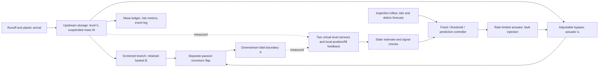

# Mathematical model and controller specification

Status: executable first-stage feasibility model. Local invert is the common vertical datum. All site geometry, loads and thresholds are synthetic and are not Mahul, Malad, Trombay or any surveyed Mumbai outlet.

## Physical arrangement

An upstream storage reach feeds a screened branch and an adjustable parallel bypass. A separate passive nonreturn flap downstream of both branches prevents reverse flow in nominal cases. The screen itself is not a tide gate. In the flap-failed case both paths permit signed backflow. No pump is modeled. A hypothetical pilot cannot replace any existing tide gate or pumping function.

## Hydraulics

State is x = (h, B, M, a): upstream level [m], basket mass [kg], suspended plastic [kg], actual bypass opening [0–1]. Input u is commanded bypass opening. Disturbances are q_in [m3/s], d [m], plastic arrival l [kg/s], blockage fraction z and equipment faults.

Water balance: dV/dt = q_in − q_out − q_spill, with V = A_s h.

Equivalent screened area: A_f = A_screen max(0.02, (1−z)(1−β B/B_max)).

Effective conductance area: A_e = A_f + A_bypass a.

Signed outlet law: q_raw = C_d κ A_e sign(h−d) sqrt(2g |h−d|).

With a functioning nonreturn flap q_out = max(0,q_raw); otherwise retain signed flow. Positive discharge is capped by available upstream water. Negative flow is clean receiving-water ingress, an explicit simplifying assumption. Excess volume above the physical rim leaves as spill and carries plastic. Levels are **not** clipped at the warning or safety threshold.

Actuator update: a_next = clip(a + clip(u−a, −r Δt, r Δt), 0, 1). Delayed commands and a zero-rate stuck fault are applied to the plant, not to the nominal predictor.

The equivalent-area law represents the conductance of two parallel paths at common head. It is not a general free-surface gate equation. It omits momentum, waves, spatial backwater, overtopping geometry, sediment, vegetation and structural loads. The storage rim is an accounting boundary, not a mapped street-flood model. Use SWMM dynamic-wave routing or a suitably validated hydraulic solver when network backwater, pressurization or rapid transients matter. Validate the local rating curve in a flume before applying any plant-specific safety conclusion.

## Conservative plastic transport

At each integration step, incoming l Δt joins M. Assume this inventory is well mixed over available water volume W. The outgoing transported mass is (M+lΔt) min(1, (max(q_out,0)Δt + V_spill)/W).

Separate the share exiting the outlet from spill. For outlet-transported mass m_o, the potential captured mass is:

c* = m_o [A_f/A_e] η0 γ / [1 + (max(q_out,0)/q_ref)^2].

Actual capture c = min(c*, max(B_max−B,0)); escaped mass is transported mass minus c. All other mass remains suspended. A full basket rejects additional capture; the model does not overflow or silently discard basket mass. A scheduled maintenance event removes basket mass into a separate cumulative ledger.

Ledger: initial basket + cumulative incoming = current basket + current suspended + escaped + removed.

“Captured” is newly retained mass and excludes initial basket inventory. Captured mass includes material subsequently removed. Neither capture efficiency nor the well-mixed approximation is empirically calibrated. Macroplastic buoyancy, size distributions, trapping, re-entrainment and tidal return of escaped litter require later transport experiments. Lower escape over a finite horizon can merely mean more material remaining upstream; report suspended inventory alongside it.

## Parameter provenance

| Parameter | Pilot value | Origin / limitation |
|---|---:|---|
| Effective storage area | 120 m2 | Synthetic lumped reach |
| Equivalent screen / bypass area | 0.16 / 0.32 m2 | Synthetic conductances; no fabrication dimensions inferred |
| C_d | 0.65 | Typical orifice coefficient mentioned in EPA SWMM manual; uncalibrated here and not a validated trash-screen value |
| Gravity | 9.81 m/s2 | Conventional near-surface approximation |
| Basket limit / fill resistance β | 40 kg / 0.85 | Synthetic; real wet mixed waste must also be characterized by volume and blockage |
| η0 / q_ref | 0.85 / 1 m3/s | Synthetic capture rolloff |
| Warning / safety / physical rim | 1.30 / 1.60 / 2.80 m | Synthetic project thresholds above local invert |
| Initial level | 0.85 m | Synthetic commissioning state |
| Full-stroke actuator time | 60 s | Synthetic actuator |
| Integration / control interval | 5 s / 30 s | Numerical choices; 2.5 s refinement tested |
| Forecast horizon | 180 s | Three 60 s action blocks |

Nominal inflow starts at 0.12 m3/s; the monsoon pulse adds up to 0.75 m3/s. Normal tide starts near 0.35 m; elevated-tide cases add a triangular excursion up to 1 m. Extreme tide is 2 m. These are stress inputs, not observed rainfall or tidal records. Rainfall is represented by its runoff hydrograph, not yet by a calibrated rainfall-to-runoff model. Debris input is 0.012 kg/s plus a 0.04 kg/s pulse. See scenarios.py for exact shapes and seeds.

## Information boundary and faults

Both adaptive controllers receive the same noisy level readings. White sensor noise has synthetic standard deviation 0.008 m. Faults run from 600–900 s: upstream bias −0.30 m; frozen level; missing level telemetry; 90 s stale packets; 90 s actuator command delay; stuck actuator; basket underestimate of 8 kg. Partial blockage is 40%; model mismatch reduces true hydraulic coefficient by 20% and capture coefficient by 30%. Maintenance empties the basket at 1200 s. The near-full case begins with 36 kg already retained.

The “communication_loss” experiment concerns the water-level telemetry stream. Position and basket feedback remain available locally. Complete power loss, loss of all signals, gradual bias, simultaneous faults and partial actuator-speed loss are **not yet tested**. The fault logger knows the injection schedule; controllers do not receive that schedule. Basket and position feedback are idealized except for the declared basket error.

Signal checks use missing/stale packets, four exactly unchanged readings, and a 0.20 m nominal-model residual. These are heuristic checks, not validated fault diagnosis. A nominal internal model estimates unmeasured suspended mass; the optimizer never receives true suspended mass. Forecasts are deliberately imperfect advance schedules: runoff pulse shifted 30 s and reduced by 10%, debris similarly shifted/reduced, and tide biased sinusoidally. They are not a weather-forecast service. Current blockage is assumed known, another optimistic assumption to remove in later studies.

## Controllers and objective

| Controller | Decision | Information / limitation |
|---|---|---|
| A Fixed | u=0 | Screen engaged, bypass closed; no adaptive fault response |
| B Threshold | Open at h≥1.30 m; close at h≤1.10 m; close bypass at negative head | Hysteresis, same slew-limited actuator, same heuristic fallback as C |
| C Predictive | Enumerate 27 sequences of u∈{0,0.5,1} over three 60 s blocks, apply first command for 30 s, replan | Uses finite forecast and basket state; no continuous global optimizer or terminal safety proof |

First discard plans for which any prediction exceeds the operating cap at any 5 s step in any sampled uncertainty case. Nominal plus four cases combine inflow factors {0.8,1.2} and tide offsets {−0.08,+0.08} m; stress cases also add 0.025 m upstream level, 2 kg basket mass and reduce hydraulic conductance to 85%. These are sampled stresses, not every parameter combination or a probability distribution.

Among survivors minimize the arithmetic mean across stress cases of:

J = Σ_j [−c_j + 0.25 e_j + 0.01 |a_j−a_(j−1)| + 0.005 Δt max(h_j−h_warn,0)^2] + 0.02 Σ_blocks |u_b−u_(b−1)|.

Here c_j and e_j are kg captured/escaped during the step. Weight units convert the other penalties into kg-equivalent objective units; they are synthetic preferences, not economic valuations. Actuator-rate limits are enforced inside predictions. Safety filtering precedes the reward: weights cannot buy permission to violate the sampled cap. The cap sweep does not change the 1.60 m evaluation limit. Exhaustive enumeration is globally optimal only within this finite candidate set and stated horizon.

When observations are unreliable or all sampled plans fail, the fallback requests full bypass only if the lower upstream estimate exceeds the upper downstream estimate; otherwise it requests bypass closure and always raises an alert. State uncertainty grows by 0.001 m/s since the last trusted reading. This reduces the chance of opening against reverse head, but may obstruct beneficial drainage. The experiment exposes exactly that failure. Neither command is a universally safe state, particularly with a stuck actuator or failed flap. Before field work, independent drainage relief, a validated local safety interlock, operator escalation and a site-specific safe-state argument are required.

If d ≥ h_safe with a functioning flap, gravity flow is zero while h ≤ h_safe. Positive inflow then consumes finite safe storage in time no greater than A_s(h_safe−h0)/q_in for constant inflow. No interception software can remove that limitation without another flow path, pumping, additional storage or reduced inflow. This is the minimal mathematical impossibility experiment.

Use a continuous mass-balance model integrated in discrete time, plus discrete maintenance and fault events. A purely event-only simulator would miss hydraulic trajectories. NumPy enumeration suffices now; evaluate SciPy optimization only if more control degrees of freedom make enumeration impractical.
