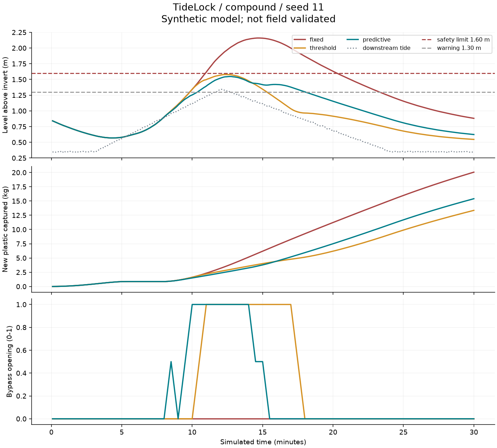
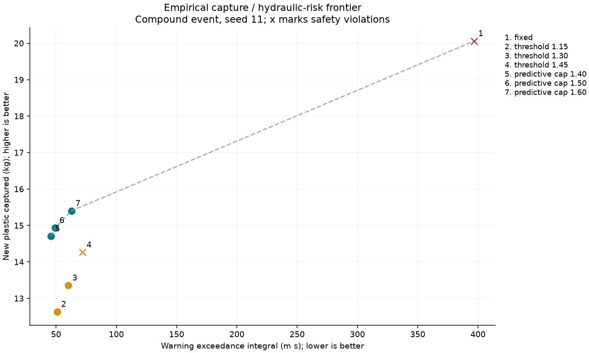
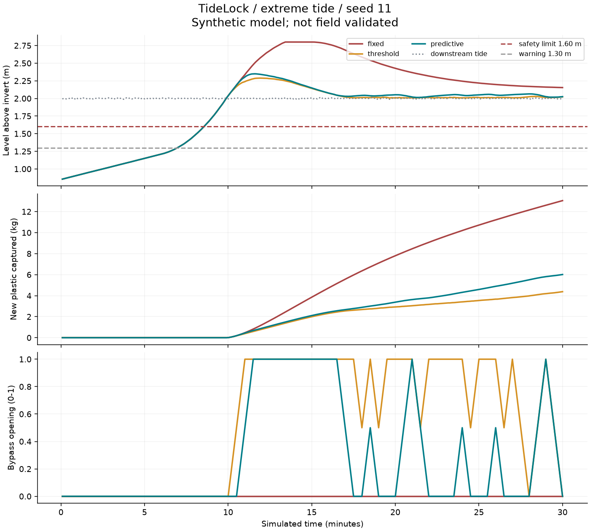
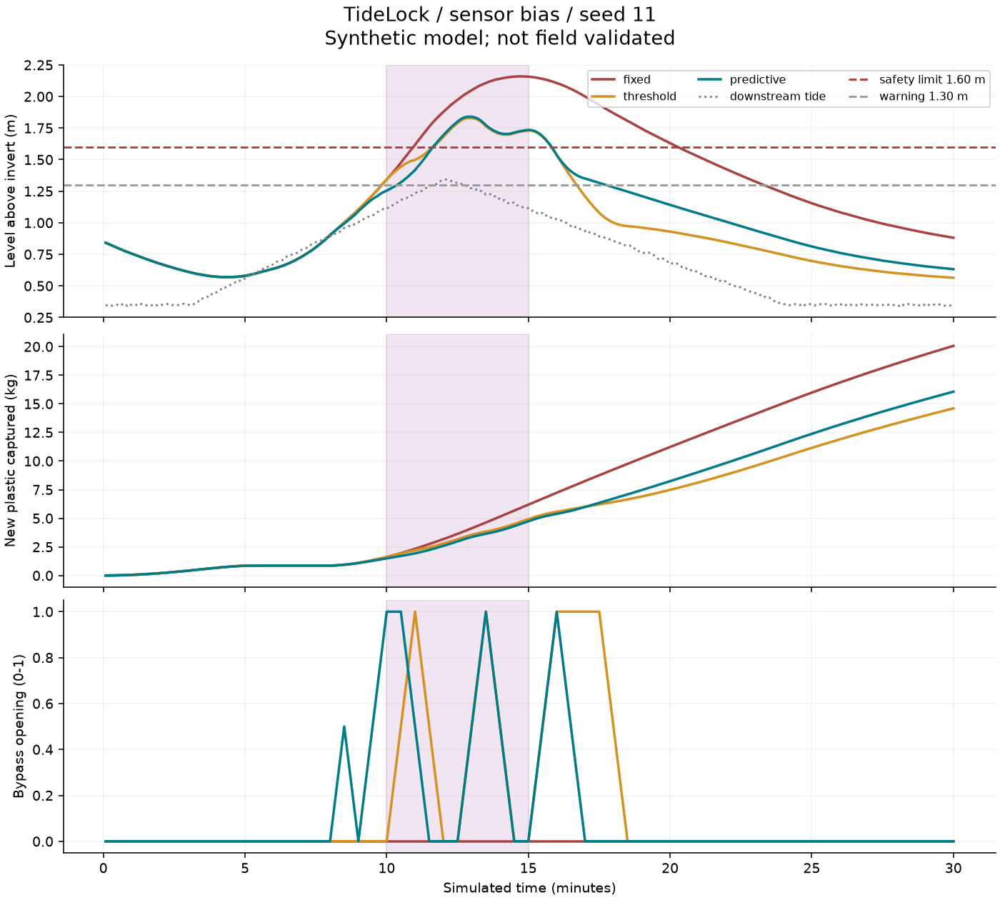

# TideLock pilot results

**Synthetic, uncalibrated model. Not evidence of real Mumbai drainage performance.**

255 runs; seeds [11, 23, 37, 51, 79]. All prescribed cases retained. Means below are descriptive, not confidence intervals.

| Scenario | Controller | Captured % | Escaped % | Peak level m | Safety violation s |
|---|---|---:|---:|---:|---:|
| ordinary | fixed | 62.7 | 12.3 | 0.850 | 0 |
| ordinary | threshold | 62.7 | 12.3 | 0.850 | 0 |
| ordinary | predictive | 62.7 | 12.3 | 0.850 | 0 |
| monsoon | fixed | 61.1 | 17.2 | 1.598 | 4 |
| monsoon | threshold | 49.3 | 32.6 | 1.388 | 0 |
| monsoon | predictive | 55.5 | 24.8 | 1.321 | 0 |
| high_tide | fixed | 60.0 | 13.4 | 1.219 | 0 |
| high_tide | threshold | 60.0 | 13.4 | 1.219 | 0 |
| high_tide | predictive | 60.0 | 13.4 | 1.219 | 0 |
| compound | fixed | 58.7 | 17.4 | 2.159 | 559 |
| compound | threshold | 39.0 | 44.6 | 1.583 | 0 |
| compound | predictive | 45.1 | 36.9 | 1.550 | 0 |
| blockage | fixed | 48.3 | 12.0 | 2.505 | 1144 |
| blockage | threshold | 31.1 | 45.9 | 1.667 | 156 |
| blockage | predictive | 35.3 | 38.1 | 1.600 | 11 |
| near_full | fixed | 11.7 | 23.5 | 2.800 | 1220 |
| near_full | threshold | 11.7 | 64.1 | 1.733 | 219 |
| near_full | predictive | 11.7 | 51.7 | 1.679 | 157 |
| sensor_bias | fixed | 58.7 | 17.4 | 2.159 | 559 |
| sensor_bias | threshold | 42.7 | 40.5 | 1.833 | 250 |
| sensor_bias | predictive | 47.1 | 34.5 | 1.845 | 220 |
| sensor_stuck | fixed | 58.7 | 17.4 | 2.159 | 559 |
| sensor_stuck | threshold | 40.8 | 42.7 | 1.623 | 45 |
| sensor_stuck | predictive | 46.3 | 35.5 | 1.649 | 60 |
| communication_loss | fixed | 58.7 | 17.4 | 2.159 | 559 |
| communication_loss | threshold | 42.7 | 40.5 | 1.833 | 250 |
| communication_loss | predictive | 46.6 | 35.3 | 1.902 | 242 |
| telemetry_delay | fixed | 58.7 | 17.4 | 2.159 | 559 |
| telemetry_delay | threshold | 42.7 | 40.5 | 1.833 | 250 |
| telemetry_delay | predictive | 46.6 | 35.3 | 1.902 | 242 |
| actuator_delay | fixed | 58.7 | 17.4 | 2.159 | 559 |
| actuator_delay | threshold | 40.8 | 42.7 | 1.838 | 175 |
| actuator_delay | predictive | 43.1 | 39.5 | 1.558 | 0 |
| actuator_stuck | fixed | 58.7 | 17.4 | 2.159 | 559 |
| actuator_stuck | threshold | 46.2 | 36.5 | 2.159 | 336 |
| actuator_stuck | predictive | 42.9 | 39.7 | 1.550 | 0 |
| capacity_error | fixed | 58.7 | 17.4 | 2.159 | 559 |
| capacity_error | threshold | 39.0 | 44.6 | 1.583 | 0 |
| capacity_error | predictive | 45.1 | 36.9 | 1.550 | 0 |
| model_mismatch | fixed | 39.7 | 33.1 | 2.294 | 689 |
| model_mismatch | threshold | 26.4 | 55.5 | 1.682 | 164 |
| model_mismatch | predictive | 30.2 | 49.5 | 1.636 | 100 |
| maintenance | fixed | 62.4 | 19.6 | 2.159 | 554 |
| maintenance | threshold | 40.2 | 45.1 | 1.583 | 0 |
| maintenance | predictive | 46.9 | 37.7 | 1.550 | 0 |
| extreme_tide | fixed | 38.2 | 11.7 | 2.800 | 1290 |
| extreme_tide | threshold | 12.4 | 39.5 | 2.291 | 1290 |
| extreme_tide | predictive | 17.3 | 34.4 | 2.337 | 1290 |
| flap_failed | fixed | 37.4 | 16.2 | 2.800 | 1630 |
| flap_failed | threshold | 12.8 | 41.9 | 2.300 | 1630 |
| flap_failed | predictive | 17.2 | 37.1 | 2.301 | 1630 |

Plastic not captured or escaped remains suspended in storage. Initial basket inventory is excluded from newly captured mass.

## Predeclared checks

```json
{
  "conservation_pass": true,
  "ordinary_safety_pass": true,
  "convergence_pass": true,
  "predictive_median_compute_target_pass": true,
  "hypothesis_qualifying_scenarios": [
    "monsoon",
    "compound"
  ],
  "hypothesis_at_least_two_pass": true,
  "infeasible_extreme_tide_alert_pass": true
}
```

## Interpretation

The pilot tests the mechanics and exposes limitations. A successful conservation or runtime check does not validate the capture law, forecast, or hydraulic geometry. The hypothesis outcome must be reported as shown; no post-run tuning was used to alter these benchmark results.

Null checks were not evaluated because required scenarios were omitted. The frontier is the nondominated subset of seven tested settings on seed-11 compound conditions; it is not a global Pareto optimum. Dashed segments are visual guides, not additional achievable policies. See pareto.csv for safety violations at every point.

Warnings and violations are evaluated against actual simulated levels, not noisy sensor values. The MPC checks only 27 plans over five sampled uncertainty cases and can miss other feasible actions. Some alerts mean this limited candidate set is infeasible, not that every physical control strategy is impossible.








